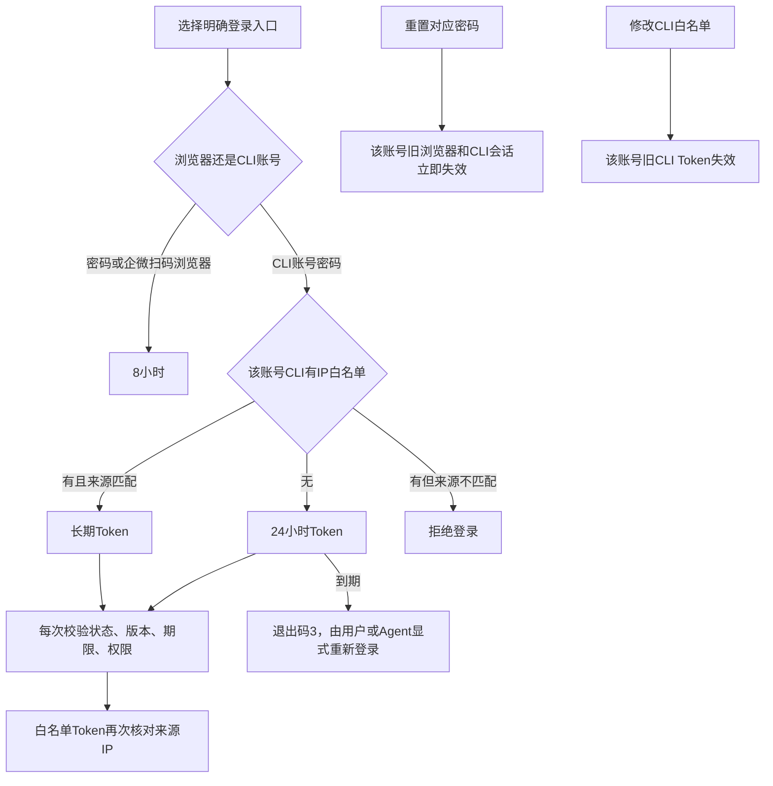

# CLI 登录、期限和撤销

账号就是已有 CRM 管理账号。`auth login --username` 明确进入 CLI 认证入口，不依赖浏览器、User-Agent 或是否由 Agent 启动。密码只在本次 HTTPS 登录中使用，CLI 不保存密码、不自动续期、不自动重登。

| 入口 | 期限 | 每次请求的校验 |
|---|---|---|
| CLI 账号，无 IP 白名单 | 登录起 24 小时 | 账号状态、密码/会话版本、CLI 策略版本、期限、原业务权限 |
| CLI 账号，有 IP 白名单 | 无自动到期时间 | 上述项目及真实来源 IP 必须匹配；不是任意地点长期可用 |
| 浏览器密码登录 | 登录起 8 小时 | 既有浏览器会话与业务授权 |
| 浏览器企微扫码登录 | 登录起 8 小时 | 同上；扫码身份仍由真实 Provider 验证 |



这里的“长期”仍可撤销。退出、账号禁用、密码重置、CLI 策略变更都受服务端实时校验。更新白名单会使旧 CLI Token 失效，须重新登录；浏览器会话不因 CLI 策略变更而失效。已有长期 Token 不会在删除白名单后继续有效。

第一性原理只有四项：凭据属于谁、有没有过期、来源是否允许、当前有没有业务权限。期限不产生额外权限；白名单不是账号，也不识别 Agent。固定服务器和流动 Agent 若要使用不同白名单策略，应使用分别授权的账号。

## 交互登录

```sh
aicrm-cli profile add production https://your-crm.example
aicrm-cli profile use production
aicrm-cli auth login --username YOUR_CRM_USERNAME
aicrm-cli auth whoami
aicrm-cli doctor
```

密码在终端隐藏输入。默认将返回的 Token 和 CSRF 凭据保存到系统密钥环；不在普通输出中打印。Origin 精确绑定，重定向不会转发凭据。旧版本保存的浏览器 Cookie 仍按原 8 小时期限使用；重新执行账号登录才会取得新 CLI Token。

## 没有桌面密钥环的服务器或 Agent

由调用方安全提供密码 stdin，并显式选择一个尚不存在的凭据文件：

```sh
aicrm-cli auth login --username YOUR_CRM_USERNAME --secret-stdin \
  --secret-output /private/path/crm-token.json < /run/secrets/crm-password
export AICRM_CLI_CREDENTIAL_FILE=/private/path/crm-token.json
aicrm-cli auth whoami
```

密码文件由调用方管理；CLI 不创建或保存它。Token 文件仅含 `origin`、`kind`、`token`、`csrf` 等凭据，不含密码；创建权限 0600，拒绝覆盖已有文件，加载时拒绝符号链接、非普通文件、其他用户可读文件和 Origin 不匹配。使用支持该权限模型的 macOS/Linux 文件系统；Windows 优先使用系统密钥环。

`AICRM_CLI_TOKEN` 与 `AICRM_CLI_CREDENTIAL_ORIGIN` 是已有独立机器身份注入入口，优先于凭据文件；账号 CLI Token 应使用上述文件或密钥环，不能把账号 Token 塞进机器身份变量。不要把密码或 Token 放进命令参数、截图、日志、Git 或普通输出。

24 小时到期会返回认证失败、退出码 3，CLI 不调用登录接口。Agent 若获准继续工作，需显式重新执行登录并保存新凭据；不能把原写请求自动重放当作续期。过期前后发生的写请求超时或结果未知，仍先查询原操作。

`auth logout` 撤销当前账号会话并移除本地凭据。撤销响应不明时会明确报告 `server_session_revocation:not_confirmed`；本地移除不能证明服务端撤销成功。

## 配置账号 CLI 白名单

只有现有 `super_admin` 可以读取/配置。目标 `id` 是 CRM **后台账号 ID**，不是客户 `customer_id`，也不是企微员工 `userid`。先用既有账号目录核对目标，不要照抄示例 ID。

```sh
aicrm-cli docs operation access.cli-policy.get
aicrm-cli invoke access.cli-policy.get --param id=YOUR_ADMIN_ACCOUNT_ID
```

白名单文件 `cli-policy.json` 示例（文档专用地址，换成实际服务器出口 IP）：

```json
{"allowed_cidrs":["203.0.113.20/32"]}
```

```sh
aicrm-cli invoke access.cli-policy.set --param id=YOUR_ADMIN_ACCOUNT_ID \
  --input cli-policy.json --dry-run
aicrm-cli invoke access.cli-policy.set --param id=YOUR_ADMIN_ACCOUNT_ID \
  --input cli-policy.json
```

`allowed_cidrs` 必须明确提供数组；`[]` 表示新 Token 使用 24 小时，省略或 `null` 拒绝。使用 IPv4/IPv6 的 CIDR 写法；单个 IPv4 地址加 `/32`，单个 IPv6 地址加 `/128`，不传裸 IP 字符串。沿用现有规范，每次最多提交 20 项。可信代理解析由服务端配置控制，不接受调用方自行填写一个“允许的IP”。修改自己的策略也会撤销自己的旧 CLI Token，之后须从允许来源重新登录。

直接 HTTP 登录的响应字段：

| 字段 | 含义 |
|---|---|
| `access_token` | 账号 CLI Bearer 凭据，秘密；`acl_` 前缀表示用途，不是权限 |
| `token_type` | `Bearer` |
| `csrf_token` | 写操作仍须随 `X-CSRF-Token` 发送的秘密；CLI 自动处理 |
| `expires_at` | 无白名单时的绝对截止时间；长期 Token 为 `null` |
| `automatic_renewal` | 固定 `false` |

不要把这些响应字段复制成浏览器 Cookie；CLI Token 无法作为浏览器 Cookie 登录。HTTP 入口为 `POST /api/admin/access/cli/login`，仅接收 `username`、`password`。不要把 CRM Token 与企微 `access_token` 混用。

独立的 `auth login --client-id` 保留原机器 OAuth 合同、scopes、capabilities 和资源范围。本次账号 CLI 的 24 小时/白名单规则不改变该合同；轮换某个机器 client secret 只影响相应机器客户端，不重置人类账号。

## 本次对抗性验证边界

| 攻击/边界 | 必须得到的结果 |
|---|---|
| CLI Token 当作浏览器 Cookie，或把浏览器 Token 当作 CLI Bearer | 拒绝用途混用；旧浏览器 Cookie 的兼容调用仍按原 8 小时期限 |
| 伪造代理头或换来源使用长期 Token | 使用既有可信代理链计算来源；非允许来源拒绝 |
| 修改/清空白名单后重放旧长期 Token | 拒绝旧策略版本 |
| 密码重置后重放旧账号 Token 或会话 | 拒绝旧账号版本 |
| 普通角色配置别人的 CLI 策略 | 拒绝，不提升权限 |
| 24 小时到期、8 小时边界 | 按绝对期限拒绝，不滑动延长 |
| CLI 收到过期响应 | 返回退出码 3；不自动登录、不重发写操作 |
| 可被其他用户读取的文件或跨 Origin 文件 | 本地拒绝加载 |

源码模块、真实 PostgreSQL/TLS 旅程、实际安装二进制合同和生产读回分别保存收据；局部通过不称全仓回归。浏览器真实企微扫码和真实群发结果另外记录。
