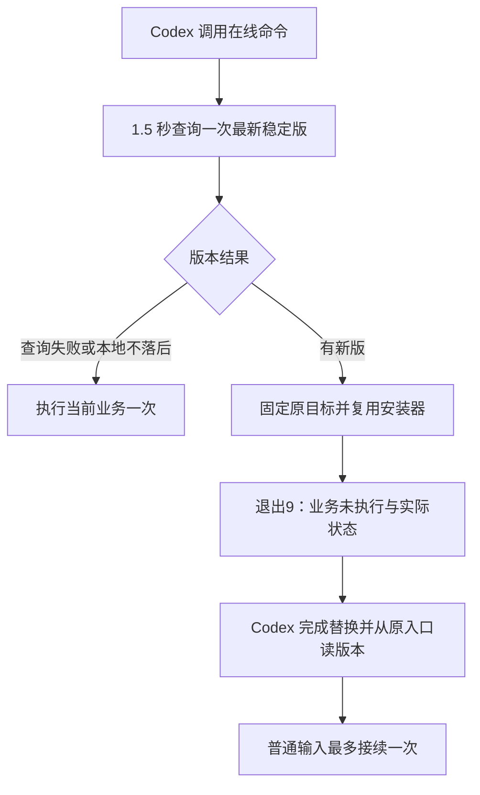

# CLI 更新最小 PRD（已批准增量）

用户目标：伙伴使用同一个原入口，发现落后时先更新；升级期间业务执行次数为零，完成后由 Codex 最多接续一次。普通旧调用及固定程序保持兼容。

参考：[飞书启动通知](https://github.com/larksuite/cli/blob/main/cmd/root.go)、[飞书更新命令](https://github.com/larksuite/cli/blob/main/cmd/update/update.go)。借鉴原安装入口与更新分离；不引入 Skills 同步、npm、进程接力或恢复器。

分类：OneID 不涉及；本地文件替换及公开 GitHub 信息读取。复用既有安装锁、备份、摘要校验、原子替换与回滚。不增加身份、服务端 API、表、Worker 或企微业务写入。没有 UI 变更。

必要限制：锁内 SemVer 判断防止慢更新覆盖更高版本；未知目标变化时停止防止覆盖其他安装；一次性输入不重放避免秘密缓存和重复业务。不存在跨进程认证恢复或新持久任务。

最小合同及用户步骤见[版本、更新与同步](update-and-sync.md)。对抗验收覆盖新旧版、离线/超时、真实 v0.3/v0.4 原入口替换、更新乱序、固定符号链接、Windows 文件占用、业务/凭据/输入未触碰和认证隔离。交叉编译不替代 Windows 原生运行；没有真实扫码收据则保留未验证。

同批沿 PR #2 与原队列合并成一个稳定版，不独立发布旧候选，不重装 CRM、不迁移数据。
