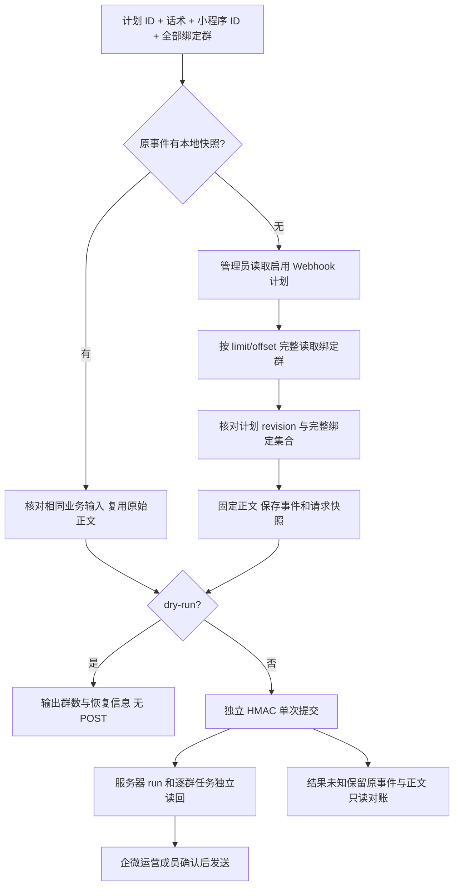

# 按计划推送全部绑定群（v0.1.3）

承接已授权的 Webhook brief。用户只提供计划 ID、话术、已有小程序素材 ID，并明确选择全部绑定群。CLI 自动读取这个计划的全部绑定群，签名提交一次请求；不查询运营成员的全部群，不修改计划，不在企微中点确认。当前计划 12 绑定 11 群，正式验证使用启用的通用日课素材 1195。

参考：[GitHub CLI api --paginate](https://cli.github.com/manual/gh_api) 展示显式完整分页；本领域沿当前 V4 `admin.getGroupOpsPlan`、`admin.listGroupOpsPlanGroups` 的 limit/offset/has_more 合同，复用 v0.1.2 的 HTTPS Origin、签名发送、错误和重放规则。[企微创建企业群发](https://developer.work.weixin.qq.com/document/path/92135) 要求成员确认。选择 CLI 编排现有读取与签名接口；服务端增加另一套 all-groups 端点或 shell/jq 手工拼装会增加合同或调用负担，无必要。

OneID：不涉及客户/身份解析，只使用计划 Owner 返回的 opaque 群引用。执行：管理员 Provider 无关读取 + 向现有 Owner 提交群发意图；Provider 写继续由服务器 outbound/External Effects 承担。持久化：本机 0600 请求快照只保存事件、Origin、计划 revision 和正文，不存凭据、不新建服务器队列；拒绝不完整/变化的分页，以免漏群。无 UI、数据库迁移和服务端部署。

命令 `group-ops webhook push --plan-id ID --text TEXT --miniprogram-id ID --all-bound-groups [--event-id ID] [--dry-run]`。不传事件时为新推送产生随机事件，写入快照并在发送前输出恢复信息；同事件同输入复用固定快照、同事件输入变化拒绝，不重新取群导致旧事件正文漂移。dry-run 会做管理员 GET 和保存快照，无 HMAC 读取或 POST；复制事件可随后提交相同正文。正常退出表示受理，非最终送达。

验收：完整分页（超过 100 群）、精确范围、计划状态/空群/异常或变化分页拒绝、登录和签名隔离、快照落盘失败零 POST、原事件固定正文及输入冲突、自动事件与 dry-run 零写、未知结果不重试。实际提交计划 12 的 11 群 + 通用日课卡片，读回同一 run 的 11 个执行；验证服务器/Provider 任务并注明员工未确认和未送达，随后发布 GitHub v0.1.3 五平台构件。
