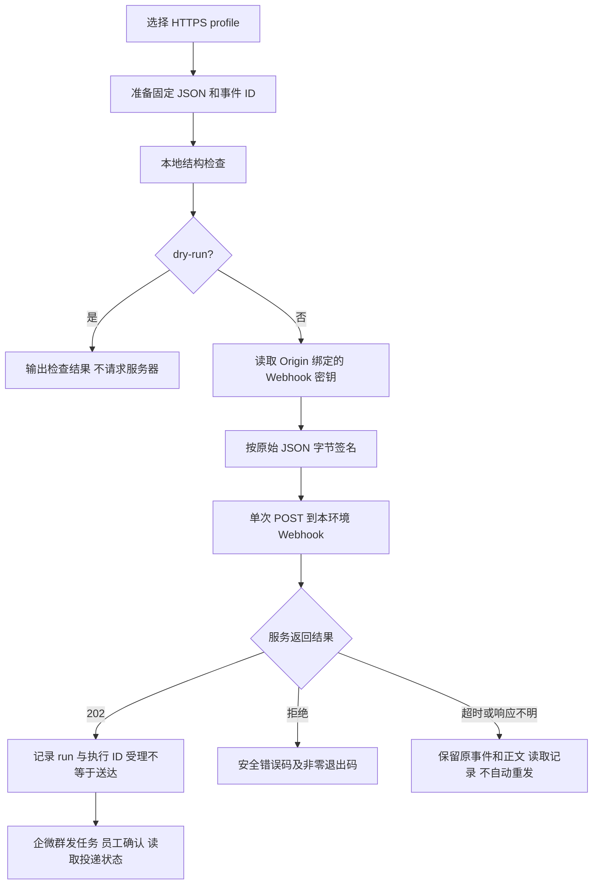

# 群运营 Webhook CLI 封装 PRD

用户授权将现有群运营 Webhook 能力封装到独立 CLI、提供说明书并提交对应 GitHub 版本。复用当前 AI-CRM-v4 应用 c52c738 的签名、消息形状与幂等合同；不修改服务端业务。

参考：当前 V4 `docs/contracts/groupops-webhook-inbound.md` 与 Composition/验签实现；[Go 标准 HMAC](https://pkg.go.dev/crypto/hmac)、[既有 go-keyring](https://github.com/zalando/go-keyring)、[GitHub Release](https://cli.github.com/manual/gh_release_create)、[企微创建企业群发](https://developer.work.weixin.qq.com/document/path/92135)。官方来源确认群发需成员确认，指定群需企微 4.1.10+。

方案比较：通用任意 URL/头命令容易转发凭据；只保留外部脚本难以发现和安装；选择固定协议专用子命令，复用 profile、HTTPS/拒绝重定向、HTTP/1 单次写传输、StrictJSON 和既有输出规范。

OneID：不涉及新身份解析或客户主键。持久化：profile 沿用，Webhook 密钥在独立服务名的系统密钥环按 HTTPS Origin 保存，或由 Origin 绑定环境注入，不覆盖人类/机器凭证。业务写：仅向当前 V4 Owner 提交 signed 意图，事务、任务、outbound/External Effects 和 Provider 仍由服务器拥有；客户端没有重试、队列或 Provider 调用。

交付 v0.1.2：`group-ops webhook configure/status/forget/send`，`schema webhook`。send 使用完整 JSON 文件或 stdin、必填调用方稳定 event ID，客户端产生当前时间戳并签名；dry-run 不需密钥、不发网络请求。环境为 `AICRM_CLI_GROUP_OPS_WEBHOOK_SECRET` 与 `AICRM_CLI_GROUP_OPS_WEBHOOK_ORIGIN`。不接受密钥参数、任意 URL、调用方签名或自动换 event ID。

限制均来自现有协议：HTTPS Origin，64 KiB 请求体，32–4096 字节无首尾空白密钥，16–256 ASCII 可见字符事件 ID，稳定引用/目标、首条可选文本与最多九附件/一个小程序。时间窗口由服务器判断。JSON 保留原始字节签名发送。素材引用及绑定权限最终由 Owner 判断。

验收：原 CLI 客户端测试；真实协议签名与字节保持、重复事件、错误/未知结果且不重试；Origin/重定向/会话隔离；密钥配置/删除/无明文降级；正文、目标、素材、事件拒绝及 dry-run 零网络；五平台发行与独立下载校验。本机仍为账号 10，只配置受保护 Webhook 密钥并核验本地预检查，不触发真实群发。

说明书必须包含安装、环境选择、密钥配置、读取群引用、文字/图/文件/小程序请求、dry-run/正式提交、返回状态及投递读取、原事件安全重放、错误表、自动化和解绑。注册服务端目录仍为 564 项/群运营 54 项；四个 Webhook 本地命令不改写服务端发现或机器授权。
