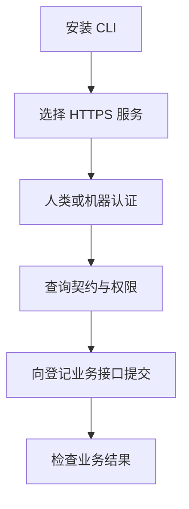
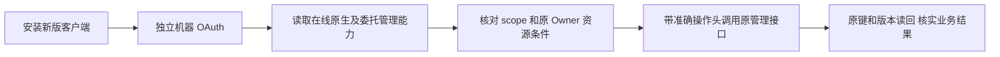

# 独立 CLI 交付

复用现有业务能力与授权后的 CLI brief。仅提取 HTTP 客户端、环境读取和无秘密接口目录；建立全新 Git 历史。

不涉及 OneID 匹配或客户主键写入。持久化仅为本地非秘密配置和系统密钥环；所有业务写入由服务端处理。参考 GitHub CLI 独立分发、Go 模块安装与 Cobra 命令组织：https://cli.github.com/manual/gh_repo_create 和 https://github.com/spf13/cobra。

交付要求：独立构建及原有客户端合同测试、五个平台构建、全新历史、公开访问和 Release 下载校验。没有真实 Provider 写验收。

构建验证：客户端 16 项测试通过，无 skip；Darwin/Linux amd64、arm64 及 Windows amd64 均构建成功。真实已授权人类会话认证读取成功；不执行外部业务写入。

## 2026-10-14 同步 brief

用户授权本机登录、同步 GitHub 最新版并列出完整群运营能力。复用上述业务流程和参考，不增加业务功能、数据库、Provider 调用或 UI。

源为当前 AI-CRM-v4 已安装应用提交 `c52c738e0c68de928a48d87bfaceb39f354c0290`；生产累计源码 `19748dcc4919108aea45ebc4181166cc6928efe9` 的 CLI 文件与该应用相同。提取 HTTP 客户端、客户端相关测试、无秘密目录和能力索引；仅调整独立 Go 模块 import 与版本标识。OneID 不涉及；持久化仅本地配置和系统密钥环；所有外部业务效果仍沿服务端 Owner 原合同。

验收要求：564 项目录（512 human、20 machine、32 无执行绑定）、54 项群运营命令与源契约一致；原合同与新增等待截止时间、私信控制、执行回执测试实际通过；五个平台构建，发行二进制版本为 0.1.1，归档校验和可核验。本机保持既有账号 10 登录，执行认证诊断和群运营读取；生产写操作及 Provider 群扫描不属于本次验收。

沿用 GitHub CLI 独立分发，发行方式参考 [gh release create](https://cli.github.com/manual/gh_release_create)。新 tag `v0.1.1` 保留旧版，不覆盖 `v0.1.0`。

## 2026-10-15 账号 CLI 与离线说明书

复用 V4 已批准认证 PRD：账号 CLI 显式登录，无白名单24小时，有白名单逐次核对来源且长期有效；不自动续期。浏览器8小时。导出最少客户端差异，保留既有 Webhook、本地快照和独立机器身份。发布必须在 V4 生产确认后进行。

说明书流程：用户/AI检索命令或官方主题 → 读取精确CRM合同及其字段/示例 → 需要企微语义时读取带来源的官方参数表 → 核对真实权限 → 显式执行 → 查原业务结果。官方正文不可用时返回明确缺口；目录存在不代表官方正文、CRM接入或Provider验收。参考企微官方 CLI 的 schema/doc 自发现：https://github.com/WecomTeam/wecom-cli/blob/main/docs/cli-reference.md。

OneID：不新增身份解析，仅解释现有字段命名空间。执行：离线公开文档读取及既有HTTP调用；无新增数据库、队列、Provider写入或UI。安全限制仅复用凭据Origin绑定、私有Token文件、不可重试未知写入；官方示例是资料，不执行其中代码。

验收：保留全部既有CLI测试，核对账号Token失败不自动重登；离线搜索/精确读取、字段引用展开、未知字段语义明确标记；五平台发行包包含根README、手册及校验和。全站官方正文若受访问限制，逐项登记覆盖，不以全目录冒称全文完成。

## 2026-10-17 受管机器 CLI 同步

用户明确要求 CLI 代码更新后同步原 GitHub 仓库，避免外部调用仍使用旧版。复用本 brief 的流程与官方参考，不重复新增协议或部署服务器。

OneID：不涉及新解析或关联；执行：同步公开 HTTP 客户端、目录及说明书，保留原本地配置/凭据边界，所有业务写仍由服务器 Owner 处理。

从已通过生产验收的 V4 应用 c11d58f13b29f092ca95d1f9b4eb28ce2e28de1e（累计源码7ad5e6fc5a44d658e4ff7e42f33f9ae916106c24）提取本次相关 client.go、catalog/machine.go、目录及相关客户端回归。只调整 Go 模块 import 与既有环境 shim，不导出服务器、运行配置、账号或业务数据。原 Webhook、离线官方资料和版本功能保留；不移入无关的 RPA Markdown 本地编排助手，登记接口仍可按其 JSON 合同调用。

验收：独立仓全部既有客户端测试及新增完整机器/只读/无委托边界通过；编译目录578项（525管理、21原生、32无绑定），新版可发现并调用显式委托管理命令；五平台构建、压缩包文档和校验和核对。本机与私网生产仅做鉴权和读取，不审核、批准、创建或发送业务任务。发布v0.3.0保留旧tag并更新latest下载。
