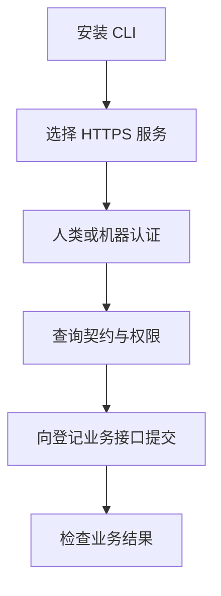

# 独立 CLI 交付

复用现有业务能力与授权后的 CLI brief。仅提取 HTTP 客户端、环境读取和无秘密接口目录；建立全新 Git 历史。

不涉及 OneID 匹配或客户主键写入。持久化仅为本地非秘密配置和系统密钥环；所有业务写入由服务端处理。参考 GitHub CLI 独立分发、Go 模块安装与 Cobra 命令组织：https://cli.github.com/manual/gh_repo_create 和 https://github.com/spf13/cobra。

交付要求：独立构建及原有客户端合同测试、五个平台构建、全新历史、公开访问和 Release 下载校验。没有真实 Provider 写验收。

构建验证：客户端 16 项测试通过，无 skip；Darwin/Linux amd64、arm64 及 Windows amd64 均构建成功。真实已授权人类会话认证读取成功；不执行外部业务写入。

## 2026-10-14 同步 brief

用户授权本机登录、同步 GitHub 最新版并列出完整群运营能力。复用上述业务流程和参考，不增加业务功能、数据库、Provider 调用或 UI。

源为当前 AI-CRM-v4 已安装应用提交 `c52c738e0c68de928a48d87bfaceb39f354c0290`；生产累计源码 `19748dcc4919108aea45ebc4181166cc6928efe9` 的 CLI 文件与该应用相同。提取 HTTP 客户端、客户端相关测试、无秘密目录和能力索引；仅调整独立 Go 模块 import 与版本标识。OneID 不涉及；持久化仅本地配置和系统密钥环；所有外部业务效果仍沿服务端 Owner 原合同。

验收要求：564 项目录（512 human、20 machine、32 无执行绑定）、54 项群运营命令与源契约一致；原合同与新增等待截止时间、私信控制、执行回执测试实际通过；五个平台构建，发行二进制版本为 0.1.1，归档校验和可核验。本机保持既有账号 10 登录，执行认证诊断和群运营读取；生产写操作及 Provider 群扫描不属于本次验收。

沿用 GitHub CLI 独立分发，发行方式参考 [gh release create](https://cli.github.com/manual/gh_release_create)。新 tag `v0.1.1` 保留旧版，不覆盖 `v0.1.0`。
